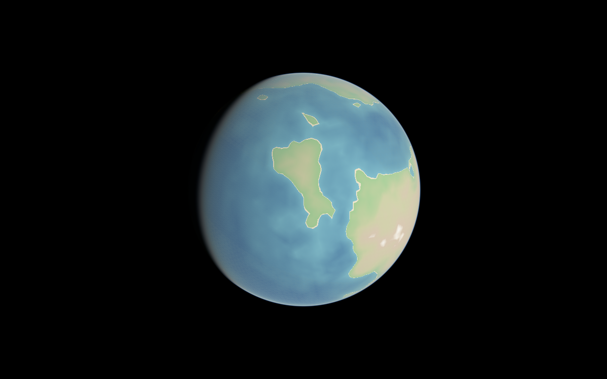

# Uncanny Planet

A procedurally generated Earth-like planet viewer for macOS. [AGENTS.md](AGENTS.md) is the specification; [DEVELOPMENT.md](DEVELOPMENT.md) lists planned work.



## Building and running

With Zig 0.17+ and Xcode's command-line tools:

```sh
zig build run   # build and launch
zig build test  # core tests
```

Enter a seed (any text, such as `perihelion`) on the panel and choose Generate. Drag to look; scroll to zoom; W/S, A/D, and R/F fly; Q/E roll; Shift goes faster; M shows the mesh; `,` and `.` slow and speed time. The globe button starts a new planet.

Command-line switches skip the panel and open straight to a planet; `--help` lists them:

```sh
"zig-out/Uncanny Planet.app/Contents/MacOS/Uncanny Planet" --help
```

For example, to start beside the highest peak with 30× relief and time paused:

```sh
zig build run -- --seed perihelion --exaggeration 3000 --distance 1.12 \
  --look-at peak --time-speed 0
```

Every switch takes a value. AppKit reads arguments in `-key value` pairs and opens any leftover argument as a file, which suppresses the window.

To render a still without opening a window, as for the image above:

```sh
"zig-out/Uncanny Planet.app/Contents/MacOS/Uncanny Planet" \
  --snapshot docs/perihelion.png --seed perihelion --direction 1,0.3,1
```

The elevation is a placeholder (warped fractal noise) until tectonics lands.

## Design notes

* **Reproducible planets.** Generation is deterministic, so a seed and its parameters fully describe a planet; there's nothing to save or export.
* **Region scale.** Values above 1 exaggerate regions, simplifying the planet as seen from orbit; below 1 would be absurd in a different way, so it isn't allowed.
* **Memory.** A full 12-level icosphere has 10·4¹²+2 ≈ 168 million vertices, about 670 MB per 32-bit field, more than an 8 GB M1 can hold across all fields. So only a coarse level is stored globally, and finer levels are generated around the camera.
* **Vertex addresses.** A vertex on a shared edge or corner is reachable by several subdivision paths; picking the lowest gives it one detail value, so neighboring triangles don't crack apart.
* **Detail field.** Hashing (seed, address) alone yields uncorrelated white noise; midpoint displacement with shrinking amplitude turns it into natural-looking terrain.
* **Time.** Only human-scale phenomena change while time runs; geology is generated once.

## Prior art

* [PISES: The Icospherical World Model](https://www.youtube.com/watch?v=LqNOHvYneYk) by Keegan Tawa (video)

## How it was made

Uncanny Planet was written with [Claude](https://claude.com).

## License

BSD 3-Clause; see [LICENSE](LICENSE).
