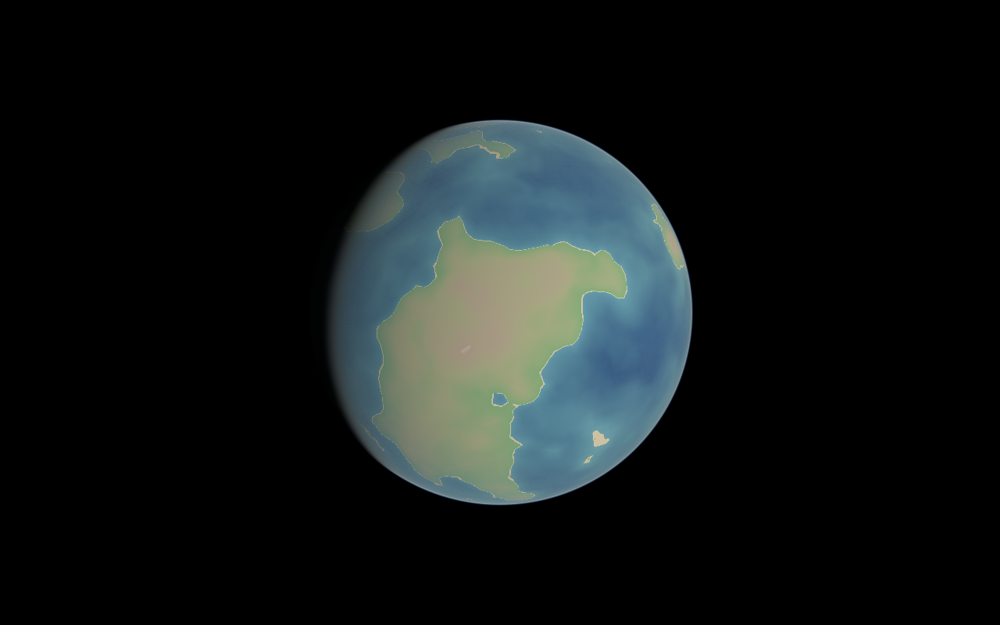

# Planet

A procedurally generated Earth-like planet viewer for macOS. [AGENTS.md](AGENTS.md) is the specification; [DEVELOPMENT.md](DEVELOPMENT.md) lists planned work.

[](docs/demo.mp4)

[Watch the flight](docs/demo.mp4): two minutes, looping, over the planet "perihelion" with relief exaggerated 50×, through the atmosphere and a sunset (1080p60, 43 MB).



## Building and running

With Zig 0.17+ and Xcode's command-line tools:

```sh
zig build run   # build and launch
zig build test  # core tests
```

### Running a downloaded copy

Planet isn't notarized: the linker signs it ad hoc, which is enough for a copy built on the same Mac. A copy downloaded from the internet (or received through AirDrop or Messages) is quarantined, so macOS refuses to open it, saying it can't be verified or is damaged. If you trust where it came from, either:

* remove the quarantine, then open it as usual:

  ```sh
  xattr -dr com.apple.quarantine Planet.app
  ```

* or try to open it once, then choose Open Anyway in System Settings › Privacy & Security, and confirm.

Building from source avoids quarantine altogether.

Enter a seed (any text, such as `Mihira`) in the sidebar and choose Generate. The sidebar's View section adjusts the rest while you fly; ticks under the sliders mark Earth's values. Drag to look; scroll to zoom; W/S, A/D, and R/F fly; Q/E roll; Shift goes faster; M shows the mesh; B toggles LOD blending; H turns the air off and on, `[` and `]` adjust its density, and `-` and `=` adjust the relief; `,` and `.` slow and speed time; Space pauses and resumes it. Edit the seed or region scale and choose Generate for a new planet; the globe button resets everything to Earth's values.

Command-line switches open straight to a planet, with the sidebar closed unless `--sidebar open`; `--help` lists them:

```sh
"zig-out/Planet.app/Contents/MacOS/Planet" --help
```

For example, to start beside the highest peak with 30× relief and time paused:

```sh
zig build run -- --seed Mihira --exaggeration 3000 --distance 1.12 \
  --look-at peak --time-speed 0
```

Every switch takes a value. AppKit reads arguments in `-key value` pairs and opens any leftover argument as a file, which suppresses the window.

To render a still without opening a window, as for the image above:

```sh
"zig-out/Planet.app/Contents/MacOS/Planet" \
  --snapshot docs/mihira.png --seed Mihira --direction 1,0.3,1
```

To render a looping flight video (2 minutes at 1080p60 takes about 6 minutes on an M2, mostly the atmosphere):

```sh
"zig-out/Planet.app/Contents/MacOS/Planet" \
  --seed Mihira --exaggeration 5000 --video demo.mp4
```

The demo above was rendered at 50 Mbps, then re-encoded with x264 to fit the repository (SSIM 0.996 and PSNR 52.1 dB against the master). [docs/demo.md](docs/demo.md) has the full directions for re-recording it: the flight's design, the poster frame, and the checks.

```sh
Planet --seed Mihira --exaggeration 5000 --video master.mp4 --bitrate 50
for pass in 1 2; do
  ffmpeg -y -i master.mp4 -c:v libx264 -preset slow -b:v 2900k \
    -maxrate 4500k -bufsize 9000k -pass $pass -profile:v high \
    -pix_fmt yuv420p -g 120 -color_primaries bt709 -color_trc bt709 \
    -colorspace bt709 -movflags +faststart -an \
    $([ $pass = 1 ] && echo "-f mp4 /dev/null" || echo docs/demo.mp4)
done
```

The elevation is a placeholder (warped fractal noise) until tectonics lands.

## Performance

`--benchmark <frames>` renders offscreen along a path that circles the planet while descending from orbit to the surface, twice (cold, then warm), and reports timings, patch counts, and memory. On an Apple M2 (10-core GPU), a release build (`zig build -Drelease`), 300 frames at 2560×1600, mesh off:

| | Cold pass | Warm pass |
| --- | ---: | ---: |
| Patches drawn / visited per frame | 574 / 1,056 | 574 / 1,056 |
| Patches generated | 7,752 (0.07 ms each) | 7,336 |
| Cache hit rate | 97.6% | 97.7% |
| Frame without generation (CPU+GPU) | 0.85 ms | 1.08 ms |
| GPU frame | 0.67 ms | 0.84 ms |

Peak memory is 119 MB: the coarse mesh (11 MB), 4,096 cached patches (9.6 KB each, 39 MB), and the render targets. The path's working set (7,752 patches) exceeds the cache's 4,096, so the warm pass regenerates nearly as much as the cold one; within a frame, though, only about 2% of patches are new. Benchmarks generate synchronously, so their mean frame time includes generation; the app generates on background threads and keeps drawing the parent meanwhile.

CPU use was cut by drawing only when something changes and by computing the elevation gradient exactly (by the chain rule through the noise and its warp) instead of by finite differences, which sampled the elevation five times per vertex. Patch generation went from 0.275 to 0.072 ms (3.8×), and the benchmark's total CPU time from 5.3 to 2.2 s. In a 4 GB macOS VM, the app's CPU use as `top` reports it:

| | Before | After |
| --- | ---: | ---: |
| Idle, time paused | 17–21% | 0% |
| Idle, time running | 14–22% | 2–4% |
| Flying | ~19% | 11–23% |

Flying still draws at up to 120 fps and generates patches; the rest of its cost is noise, which midpoint displacement (planned) would mostly replace.

The figures above predate the atmosphere. With it, the GPU frame rises from about 0.68 to 4.7 ms on the same path (frames from the cache: 1.0 to 3.2–4.5 ms, CPU and GPU), mostly the per-pixel raymarch (12 view steps × 6 sun steps for terrain, 32 × 6 for the sky). A precomputed transmittance table would remove most of the sun steps.

LOD blending costs no measurable GPU time (0.616 vs. 0.612 ms per frame) and 16 bytes per vertex for the parent's values. To measure popping, 80 snapshots approaching the highest peak (30× relief, 640×400) were compared frame to frame; a pop is a frame whose change departs from the average of its neighbors' by more than 0.2 (on a 0–255 scale):

| Blending | Pops | Largest jump | Mean jump |
| --- | ---: | ---: | ---: |
| Off | 12 | 0.35 | 0.092 |
| Ending at 2× the threshold | 9 | 0.60 | 0.086 |
| Ending at 1.5× (default) | 0 | 0.15 | 0.034 |

Before patches, the renderer drew the whole coarse mesh at once, which grew 4× per level: level 9 (2.6 million vertices) took 5.1 ms of GPU per frame and 1.2 GB peak, and level 10 took 15.7 ms and 4.0 GB, while the core kept about 266 bytes per vertex where about 48 are needed (its arena keeps generation leftovers). Patches reach level 12 detail near the camera for far less.

## Design notes

* **Reproducible planets.** Generation is deterministic, so a seed and its parameters fully describe a planet; there's nothing to save or export.
* **Region scale.** Values above 1 exaggerate regions, simplifying the planet as seen from orbit; below 1 would be absurd in a different way, so it isn't allowed.
* **Memory.** A full 12-level icosphere has 10·4¹²+2 ≈ 168 million vertices, about 670 MB per 32-bit field, more than an 8 GB M1 can hold across all fields. So only a coarse level is stored globally, and finer levels are generated around the camera, as patches.
* **Patches.** Selection refines by projected triangle size, so detail follows the camera without a fixed radius. A patch's vertices come from the same midpoint normalizations as the coarse mesh and an exact gradient, so neighbors agree exactly where they share vertices; skirts cover the T-junctions where a fine patch meets a coarser one.
* **Vertex addresses.** A vertex on a shared edge or corner is reachable by several subdivision paths; picking the lowest gives it one detail value, so neighboring triangles don't crack apart.
* **Detail field.** Hashing (seed, address) alone yields uncorrelated white noise; midpoint displacement with shrinking amplitude turns it into natural-looking terrain.
* **Time.** Only human-scale phenomena change while time runs; geology is generated once.

## Prior art

* [PISES: The Icospherical World Model](https://www.youtube.com/watch?v=LqNOHvYneYk) by Keegan Tawa (video)

## How it was made

Planet was written with [Claude](https://claude.com).

## License

BSD 3-Clause; see [LICENSE](LICENSE).
